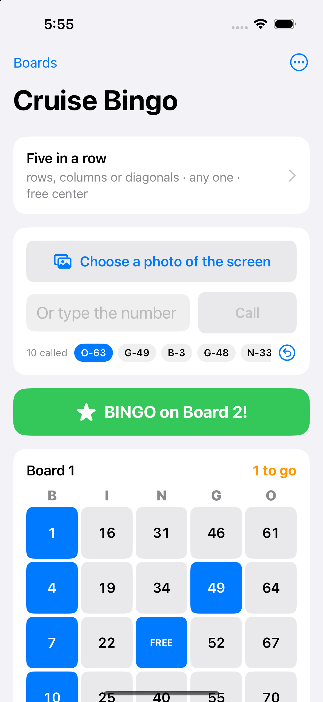

# AutoBingo (Cruise Bingo)

An iPhone app that keeps track of your bingo cards for you. Add your boards (type them in or
snap a photo of each card), then enter each called number (type it, or take a photo of the
caller's screen). The app marks every board, tells you how close each one is, and shouts
**BINGO** when one wins.



## Features

- **Any number of boards**: save boards, group them, and choose which are in play.
- **Board photos**: read all 25 numbers from a photo of a card using Apple Vision. Squares
  the app isn't sure about are highlighted so you can check them against the photo.
- **Call photos**: read the called number from a photo of the bingo screen, with a
  confirmation step before it's applied.
- **Caller's board photos**: read every lit number from a photo of the caller's full board
  and replace the called numbers in one go.
- **Winning rules**: five in a row, chosen B/I/N/G/O columns, shapes (2×2, 3×2, T, blackout
  or a custom drawn pattern) placed anywhere, at corners, or exactly as drawn, with
  "any one", "at least N" or "all" occurrences. Free center can be turned on or off.
- **Near-win hints**: shows how many squares each board still needs and highlights them
  when it's close.
- **Undo and history**: undo the last call or delete any call; the game saves automatically.

## Requirements

- Xcode with the iOS 17 SDK or later (the app targets **iOS 17**)
- macOS 14 or later to run the `BingoKit` tests and the `bingo-ocr` tool

## Getting started

Open `AutoBingo.xcodeproj` in Xcode and run the **AutoBingo** scheme, or use the command line:

```bash
./dev.sh run
```

This builds the app and launches it in the iPhone 16 Pro simulator. Pick another simulator
with `SIM_NAME`, e.g. `SIM_NAME="iPhone 17" ./dev.sh run`.

## Development commands

`dev.sh` does everything without opening Xcode:

| Command | What it does |
|---|---|
| `./dev.sh test` | Run all unit tests (engine + recognition) |
| `./dev.sh build` | Build the app for the simulator |
| `./dev.sh run` | Build, install and launch in the simulator |
| `./dev.sh screenshot [out.png]` | Save a screenshot of the simulator |
| `./dev.sh photos` | Add `TestPhotos/*` to the simulator's Photos (skips ones already there) |
| `./dev.sh ocr photo.jpg ...` | Show which called number the app reads from a screen photo |
| `./dev.sh ocr-board card.jpg` | Show the 5×5 numbers the app reads from a card photo |
| `./dev.sh ocr-called screen.jpg` | Show which numbers are lit on a photo of the caller's board (`OVERLAY=out.png` saves the boxes drawn on the photo) |
| `./dev.sh demo-call photo.jpg` | Launch straight into "Confirm call" for that photo and screenshot it |
| `./dev.sh demo-board card.jpg` | Launch, scan that card into Board 1, and screenshot it |
| `./dev.sh demo-bulk a.jpg b.jpg` | Launch, add a board for each card photo, and screenshot it |

The `demo-*` commands use debug-only launch arguments and do nothing in release builds.

## Project layout

```
AutoBingo.xcodeproj        Xcode project
AutoBingo/                 the iPhone app (SwiftUI views, game state and saving)
BingoKit/                  Swift package
├── Sources/BingoKit/          bingo rules: boards, patterns, winning rules, engine
├── Sources/BingoRecognition/  photo → Apple Vision OCR → boards and called numbers
├── Sources/bingo-ocr/         command-line tool used by ./dev.sh ocr*
└── Tests/                     unit tests, including OCR on generated images
dev.sh                     command-line helpers
```

The bingo rules live in `BingoKit` with no UI or camera code, so they can be tested on a Mac.
Photo recognition only produces numbers, which flow into the same engine as typed input.

## More docs

- [DEVELOPMENT_PLAN.md](DEVELOPMENT_PLAN.md): design decisions, how winning rules work, and progress by phase
- [disney_cruise_bingo_project_plan.md](disney_cruise_bingo_project_plan.md): the original requirements
